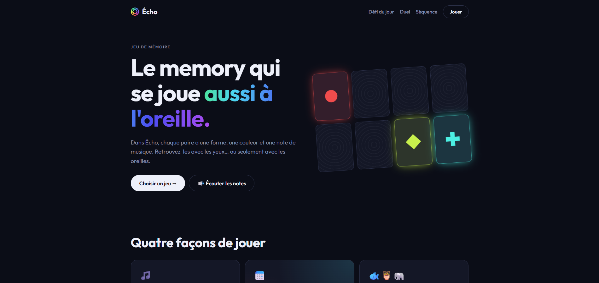

# Écho · Le memory qui se joue aussi à l'oreille

> Jour 02 du défi **30 jours, 30 projets** · React et Vite



Dans Écho, chaque paire de cartes a **une forme, une couleur et une note de musique**. Les couleurs suivent la hauteur des notes, du rouge pour les graves au violet pour les aiguës : on mémorise avec les yeux… ou seulement avec les oreilles.

🔗 **Démo :** [echo.projectp.fr](https://echo.projectp.fr/)

📄 Ce qui a été construit, règle par règle : le [cahier des charges](CAHIER_DES_CHARGES.md).

## Quatre jeux

### 🎵 Memory musical

- **3 niveaux** : Facile (6 paires), Moyen (8) et Difficile (12).
- **2 modes** : Classique (formes, couleurs et sons) et **Écoute**, où les cartes ne montrent rien et où seul le son guide.
- **Un score qui récompense la mémoire** : 100 points par paire multipliés par la série en cours, **« Oubli »** −30 quand on rate une carte déjà vue, et un bonus de temps à la fin.
- Chronomètre, coups, précision, et **meilleur résultat sauvegardé** pour chaque niveau et chaque mode.

### 📅 Défi du jour

- **La même grille pour tout le monde**, calculée à partir de la date, et **une seule tentative** par jour.
- Une série 🔥 compte les jours d'affilée.
- **Le résultat se partage** sous forme de grille d'emojis, à la manière de Wordle.

### 🐟🦉🐘 Duel contre l'ordinateur

- Chacun son tour : une paire trouvée permet de rejouer.
- **Trois adversaires** à la mémoire plus ou moins bonne : Poisson rouge, Hibou, Éléphant. Leurs niveaux ont été réglés en simulant des milliers de parties.
- L'ordinateur hésite, vise une carte avant de la retourner, et commente ses coups. Le bilan est gardé contre chaque adversaire.

### 🎹 Séquence

- Une suite de notes à rejouer sur des pads. Elle **s'allonge et accélère** à chaque manche.
- 4, 6 ou 9 pads, mode Écoute, un joker « Réécouter », jeu au clavier (touches 1 à 9), et un record par niveau.

## Structure

```
src/
├── pages/        Landing, Game (memory), Daily (défi), Duel, Sequence
├── components/   Card, Board, Stats, GameHeader, EndModal, DailyResult, Shape
├── hooks/        useMemoryGame (mécanique d'une partie), useMuted
└── lib/          Règles et logique, sans affichage :
                  deck, game, daily, duel, sequence, audio, storage
```

- **Navigation** par l'ancre de l'adresse (`#/jouer`, `#/defi`, `#/duel`, `#/sequence`), sans bibliothèque de routage.
- **Sons** synthétisés avec la Web Audio API : aucun fichier audio.
- **Sauvegarde** des records et des réglages dans le navigateur (`localStorage`).

## Lancer en local

```bash
npm install
npm run dev
```

Puis ouvrir l'adresse affichée (en général http://localhost:5173).

Pour la version de production : `npm run build` crée le dossier `dist/`. Les chemins sont relatifs (`base: './'` dans `vite.config.js`), donc le site fonctionne aussi dans un sous-dossier.

## Technologies

React 19, Vite, Web Audio API. Police Outfit (Google Fonts).
